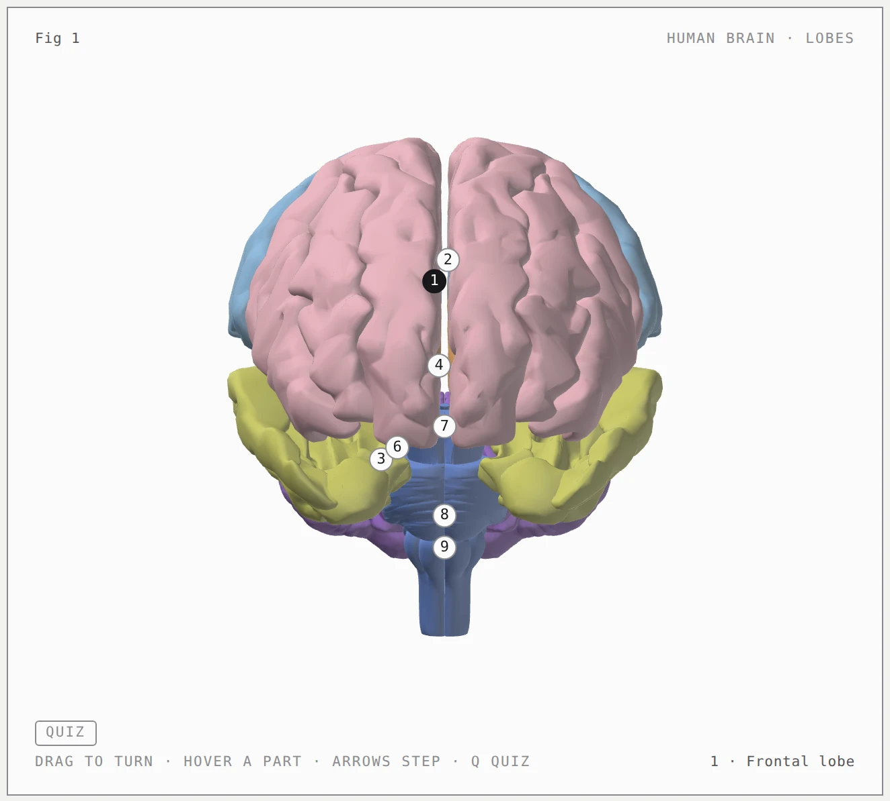

<h1 align="center">Anatomy</h1>

<p align="center"><b>A Claude skill that teaches a biological structure by building it as a model you can turn.</b><br>Rotatable 3D models from open anatomical atlases, every part in its own tissue tone, numbered, named on hover and listed in a key, in one offline HTML file. Isometric teaching models with numbered pins for the cells, circuits and sections no atlas has.</p>

<p align="center">
  <a href="https://code.claude.com/docs/en/skills"></a>
  <a href="https://agentskills.io"></a>
  <a href="LICENSE"></a>
  <a href="#requirements"></a>
  <a href="#requirements"></a>
  <a href="https://github.com/Akeel-Majeed/anatomy/actions/workflows/ci.yml"></a>
</p>

<p align="center">
  <a href="https://github.com/Akeel-Majeed/anatomy/archive/refs/heads/main.zip"></a>
  &nbsp;
  <a href="#install"></a>
</p>

<p align="center">
  <a href="#about-this-fork">About this fork</a> ·
  <a href="#quick-start">Quick start</a> ·
  <a href="#gallery">Gallery</a> ·
  <a href="#what-it-makes">What it makes</a> ·
  <a href="#install">Install</a> ·
  <a href="#usage">Usage</a> ·
  <a href="#examples">Examples</a> ·
  <a href="#how-it-works">How it works</a> ·
  <a href="#sources-and-licences">Sources and licences</a> ·
  <a href="#limits">Limits</a>
</p>

<p align="center">
  
</p>

<p align="center"><sub><code>examples/brain</code>, light theme, the whole human brain by lobe from BodyParts3D: drag to turn, hover a part to name it, Q to hide the names.</sub></p>

---

Ask Claude to show you a structure, or a system such as the limbic system, and Anatomy looks it up in an open anatomical atlas, writes a truth table of every named part with the atlas's ids and names, fetches the real meshes (no API key, cached after the first time), and builds them into one HTML file: the structure in a framed card, each part in its own tissue tone with a numbered tag, a key under the card, and the atlas and its licence in the caption. Drag to turn it, hover a part and it lights and names itself, step through the key with the arrows, press Q and the names hide so you can test yourself. It opens offline.

For what no atlas has as a mesh, a neuron with its glia, a circuit, a cut section with its layers, Anatomy draws an isometric teaching model on a stand instead: a cast with one face cut to the textbook's section, every named part its own solid with a numbered pin, and the pathways as cords that pulse in circuit order.

Then Claude checks its own work: the build fails if the key and the truth table disagree or a name differs from the atlas's own list, a headless browser proves every part is visible and every tag sits on its own part from six views, and the front, left and top are captured and read against the atlas. On the section route, the cut face is read at 4× beside the source's figure and the geometry audit proves nothing passes through anything.

## About this fork

Anatomy is a fork of [wheresryan22/anatomy](https://github.com/wheresryan22/anatomy), a skill that explains technical ideas by drawing them as invented isometric machines. A neuroscience student forked it to revise anatomy with, and turned it toward one job: accurate, labelled models of real structures. Accuracy comes first. Every part is named and numbered from a cited atlas, the build fails when a name drifts from the atlas's own list, a quiz mode hides the names so you can test yourself, and nothing needs an API key.

What changed from upstream: the main output is a rotatable 3D model built from the meshes of open anatomical atlases rather than an invented isometric machine; a truth table and build-time checks for every name; a fetcher and packer for atlas meshes; a plain-WebGL viewer in one offline HTML file; and human neuroanatomy first, systems included, so the limbic system or the basal ganglia can be seen with their parts in place. The isometric kit stays for the cells, circuits and layered sections no atlas has as a mesh.

What is unchanged: the kit, its examples and its craft rules are the upstream author's work, credited under [Credit](#credit), and the licence is still [MIT](#license).

## Quick start

```sh
npx skills add Akeel-Majeed/anatomy -g -a claude-code
```

Then, in Claude Code:

```text
/anatomy show me the brain by lobe so I can rotate it and name each one
```

That's it. No API keys and nothing to `npm install`: the kit uses only Node's built-in modules, and the atlases are public downloads.

## Gallery

<table>
  <tr>
    <td width="50%"></td>
    <td width="50%"></td>
  </tr>
  <tr>
    <td><sub><b>raptor-engine</b>: hover to take it apart into 11 assemblies. An audit proves that no pipe passes through anything, at rest, apart and in every frame between.</sub></td>
    <td><sub><b>ripple-tank</b>: SVG apparatus over two WebGL layers (lamp light and caustics on the paper, reflections in the water) driven by a dispersion and optics model.</sub></td>
  </tr>
  <tr>
    <td></td>
    <td></td>
  </tr>
  <tr>
    <td><sub><b>turning-dial</b>: the kit's turning mode (beta). About 90 parts are re-projected and re-shaded every frame as you drag the dial.</sub></td>
    <td><sub><b>dial-indicator</b>: the smallest example, about 300 lines. Hover to slide the carriage; the needle reads each block.</sub></td>
  </tr>
</table>

Every screenshot is the light theme of a page in [`examples/`](examples), captured with the skill's own [`scripts/capture.mjs`](scripts/capture.mjs) and [`scripts/drive.mjs`](scripts/drive.mjs). The built pages are committed: open any `.html` in `examples/` to try it. Screenshots of the brain and hippocampus pages follow once they are captured.

## What it makes

Four kinds of figure. All four share one card, one key, one truth table and one set of craft rules.

| Kind | What it is | Example |
|---|---|---|
| **3D model** | The main output. The real meshes of each named part from an open atlas (BodyParts3D; the skill is human-only for now), packed into one offline HTML file and drawn with plain WebGL: orbit by dragging, zoom, hover to name, arrows to step, Q for quiz, numbered tags that never float over the wrong part, and the atlas cited in the caption. A whole brain by lobe, a region with its neighbours, or a system such as the limbic system or the basal ganglia on one card, so you see how its parts sit together, with the members the atlas lacks named in the caption. | `brain`, `hippocampus-3d`, `limbic-system`, `basal-ganglia` |
| **SVG** | The section route. Solid isometric parts with four-tone shading, painted back to front, in a card with a live readout and eased motion. It ships as a standalone HTML page, a lone `.svg` file with its styles embedded, or React/Next.js components. | `hippocampus-section`, `dial-indicator`, `desk-computer`, `arcade-cabinet`, `test-rig` |
| **SVG + WebGL** | For what lines can't draw: fire, exhaust, water, caustics, lamp light, glow, steam. The shader runs in a canvas between a back and a front SVG, in the figure's own isometric camera, so it sits inside the drawing. The SVG still reads without WebGL. | `raptor-engine`, `ripple-tank` |
| **Turning parts** <sup>beta</sup> | Kit-drawn parts that turn in true 3D inside a section figure: a dial or turntable that spins, fingers that flex, a piece that breaks off and falls. The moving parts are re-projected and re-shaded by the kit's own rules every frame; the rest of the figure stays static art. | `turning-dial` |

Each figure is light or dark. Light is the theme the skill designs for first, shaders included.

## Install

Anatomy is a standard [Agent Skill](https://code.claude.com/docs/en/skills): a folder with a `SKILL.md` at its root. This repository is that folder. Pick one way in:

| | Command | Installs to |
|---|---|---|
| **skills CLI**, for you | `npx skills add Akeel-Majeed/anatomy -g -a claude-code` | `~/.claude/skills/anatomy` |
| **skills CLI**, for one project | `npx skills add Akeel-Majeed/anatomy` | `.claude/skills/anatomy` |
| **git**, for you | `git clone https://github.com/Akeel-Majeed/anatomy.git ~/.claude/skills/anatomy` | `~/.claude/skills/anatomy` |
| **git**, for one project | `git clone https://github.com/Akeel-Majeed/anatomy.git .claude/skills/anatomy` | `.claude/skills/anatomy` |
| **Download**, no git | see below | `~/.claude/skills/anatomy` |

<details>
<summary><b>With the skills CLI</b></summary>

<br>

The [`skills`](https://github.com/vercel-labs/skills) CLI finds the `SKILL.md` at the root of this repository and installs it as `anatomy`. By default it installs into the current project and asks which agents to set up. `-g` installs it for your user, and `-a claude-code` sets up Claude Code only.

The CLI copies the whole repository, examples and packed meshes included. It needs a recent Node.js: version 1.7.1 of the CLI asks for 22.20 or later.

</details>

<details>
<summary><b>With git</b></summary>

<br>

Clone the repository into one of Claude Code's skill folders, so that `SKILL.md` ends up at `<skills folder>/anatomy/SKILL.md`. For a project install, commit `.claude/skills/anatomy` so your team gets it too. To update later, `git pull` inside that folder.

</details>

<details>
<summary><b>Download, without git</b></summary>

<br>

[Download the ZIP](https://github.com/Akeel-Majeed/anatomy/archive/refs/heads/main.zip), unpack it, rename the folder from `anatomy-main` to `anatomy`, and move it into `~/.claude/skills/`.

Or in one line on macOS or Linux:

```sh
mkdir -p ~/.claude/skills/anatomy && curl -L https://github.com/Akeel-Majeed/anatomy/archive/refs/heads/main.tar.gz | tar -xz --strip-components=1 -C ~/.claude/skills/anatomy
```

</details>

Claude Code picks up new skills in a running session. If the `skills` folder itself did not exist when the session started, run `/reload-skills`.

## Usage

Type `/anatomy` and say what the figure should explain:

```text
/anatomy show me the brain by lobe so I can rotate it and name each one
```

You don't have to name the skill. Claude also loads it when you ask to see, learn, revise or label the parts of a biological structure, for a 3D brain model, or for an anatomy figure for lecture notes or a revision site.

<details>
<summary><b>More prompts</b>, from the skill's <a href="evals/evals.json">evals</a></summary>

<br>

```text
/anatomy the hippocampus with the amygdala, fornix and parahippocampal gyrus around it, in 3D so I can see how they sit. Dark theme, one HTML file.
```

```text
/anatomy show me the limbic system in 3D so I can see how the parts fit together. Light theme, one HTML file.
```

```text
/anatomy the basal ganglia, how they fit together around the thalamus, for my exam. Dark theme, one file I can open offline.
```

```text
/anatomy a pyramidal neuron with the three glial cell types around it, every part labelled so I can test myself. Dark theme, one HTML file.
```

</details>

Three habits get the best figures:

1. **Name the structure, or the system.** Anatomy finds the parts in the atlas and writes the truth table; that is most of the work. It is human-only for now. For a section, say which cut (coronal, sagittal, transverse).
2. **Paste your label list.** If your course names things a certain way, paste the labels from your lecture or textbook figure. They are used verbatim, in your order, and the atlas's own names stay in the truth table beside them.
3. **Say where it will live.** A standalone HTML page, a lone SVG file, or a React/Next.js component; light or dark.

A figure arrives as source you own: a Node build script, the truth table, the packed meshes with their licence, and the page it writes, or, for React, geometry modules, a server component for the static art and one client component for the motion. The kit comes with it.

## Examples

Each framework-free example has a Node build script that writes standalone pages next to itself. Add `--light` for the light theme.

| Example | What it shows | Build |
|---|---|---|
| [`brain`](examples/brain) | The whole human brain by lobe from BodyParts3D: the frontal, parietal, temporal and occipital lobes, the insula, the cerebellum, the midbrain, the pons and the medulla oblongata, nine numbered parts, left and right as one. Drag to turn, hover to name, arrows to step, Q for quiz. The reference for every 3D figure. | `node examples/brain/build.mjs` |
| [`hippocampus-3d`](examples/hippocampus-3d) | One card: the human hippocampus with the amygdala, fornix and parahippocampal gyrus from BodyParts3D, four numbered parts. It opens from above-left, because the hippocampus hides behind the amygdala from the front. | `node examples/hippocampus-3d/build.mjs` |
| [`limbic-system`](examples/limbic-system) | The limbic system on one card, human, from BodyParts3D: hippocampus, fornix, mammillary body, thalamus, hypothalamus, amygdala, cingulate gyrus and parahippocampal gyrus, eight numbered parts, so you see how they sit together. | `node examples/limbic-system/build.mjs` |
| [`basal-ganglia`](examples/basal-ganglia) | The basal ganglia on one card, human, from BodyParts3D: caudate nucleus, putamen, globus pallidus and the thalamus they project to, four numbered parts. The caption says the substantia nigra, the subthalamic nucleus and the nucleus accumbens are not in the atlas. | `node examples/basal-ganglia/build.mjs` |
| [`hippocampus-section`](examples/hippocampus-section) | The section route: the hippocampal formation in coronal section as an isometric teaching model, regions as prisms, layers as bands on the cut face, a pin on every part, a key generated from `truth.mjs`, the trisynaptic circuit's cords pulsing in order, hover lift and quiz mode. | `node examples/hippocampus-section/build.mjs` |
| [`dial-indicator`](examples/dial-indicator) | A dial gauge on a stand over a carriage of gauge blocks. The smallest example, about 300 lines. | `node examples/dial-indicator/build.mjs` |
| [`desk-computer`](examples/desk-computer) | A 1984-style desk computer with a keyboard you can type on. The typed line appears on a CRT drawn in the plane of the case front, and switching it off collapses the picture to a line and a dot. About 85 solids. | `node examples/desk-computer/build.mjs` |
| [`arcade-cabinet`](examples/arcade-cabinet) | An upright arcade cabinet with its side panel off. Drop a quarter: it rolls down the coin chute past the coin-switch wire into the cash box, a pulse runs along the cable to the board, and the CRT warms up into an attract mode drawn in the plane of the tilted monitor. About 240 solids and 15 cables. | `node examples/arcade-cabinet/build.mjs` |
| [`raptor-engine`](examples/raptor-engine) | A Raptor 2 engine in a test stand. It comes apart into 11 assemblies, and a WebGL plume, shock, splash and steam render between the back and front SVG. The reference for dense pipework, smooth shading, fades and the audit. The build takes a few minutes. | `node examples/raptor-engine/build.mjs` |
| [`ripple-tank`](examples/ripple-tank) | A school ripple tank on tall legs over a paper screen, seen from 44° up. Two WebGL layers are registered to the isometric planes and driven by a pure model in `model.mjs`. | `node examples/ripple-tank/build.mjs` |
| [`test-rig`](examples/test-rig) | A production figure from a React/Next.js site: a glass button on a spring-mounted carriage, a finger probe on a rail, and a dial gauge reading the lean. 53 solids. No build script: copy it into a React app. | none |
| [`spot-plate`](examples/spot-plate) | A second figure from the same site: six pairs of glass drops on a spot plate that run together into one piece of glass as a fan of feeler blades opens. Each pair is drawn from one distance field. No build script: copy it into a React app. | none |
| [`turning-dial`](examples/turning-dial) | The turning mode: a combination dial that turns in true 3D with a small robot hand on it, a three-hinge finger that lifts, and a pod that breaks off as a free body. `stress.mjs` is a 380-part hand in a cluttered workshop, used to measure performance. | `node examples/turning-dial/build.mjs` |

The 3D examples build offline from the packed meshes committed under `examples/<name>/meshes/`; `node examples/<name>/check.mjs` runs the truth check's self-test and `node scripts/view-check.mjs examples/<name>/<name>.html` proves the built page in headless Chrome. To refetch or add parts: `node scripts/atlas.mjs bp3d --find "temporal lobe"`, then `node scripts/atlas.mjs bp3d FMA72971 FMA72972 --out examples/brain/meshes`.

`node examples/hippocampus-section/build.mjs --audit`, `node examples/raptor-engine/build.mjs --audit`, `node examples/arcade-cabinet/build.mjs --audit` and `node examples/turning-dial/build.mjs --light --audit` also run the geometry audit. The turning audit is slow; see [`references/3d.md`](references/3d.md).

## How it works

- **[`SKILL.md`](SKILL.md)** is what Claude reads. It sets the workflow: read the request and decide the route, look up every part in the atlas and write the truth table, fetch and pack the meshes, write the build from the brain example, verify with the truth check, the view check and captures read against the atlas, and deliver one file saying what the atlas does not have. The section route keeps its own ten steps: size the request, fetch a cited source, choose the cut, write a parts list, plan the world, build the geometry once with the kit, paint back to front, frame it, make it live, and verify like a critic. It also holds the craft rules in short form.
- **[`scripts/atlas.mjs`](scripts/atlas.mjs)** fetches and caches the atlases under `~/.cache/anatomy/`, finds parts by name in the atlas's own list, extracts each requested part and packs it with [`kit/mesh.mjs`](kit/mesh.mjs) into a compact JSON of quantized positions, octahedral normals and indices. Node built-ins only, including the zip reading.
- **[`kit/mesh-view.js`](kit/mesh-view.js)** is the viewer inlined into every 3D page: plain WebGL 1, one shader pair, an orbit camera, colour-ID picking, the tags, the interactions and the readout, and `window.anatomy` for the checks.
- **[`kit/`](kit)** is also the drawing library the section figures are built from: the isometric camera, solids and a parts library (`iso-kit`), round parts on any axis (`lathe.mjs`), pipes and cables (`tube.mjs`), the WebGL layer (`gl.mjs`), the turning runtime (`turn*.mjs`), and React components (`react/`). Apart from React for those components, it has no dependencies. The 3D pages use its card and page builders.
- **[`references/`](references)** are the long-form guides Claude opens when it needs them: the biology side (the route, the atlases and their ids, frames, tones, the truth table, the anatomy check), craft, the kit API, motion, React, verification, WebGL, a design walkthrough and the turning mode.
- **Verification.** Every build runs the truth check. For 3D pages, [`scripts/view-check.mjs`](scripts/view-check.mjs) turns the model to six views in headless Chrome and fails unless every part is visible, every tag's anchor picks its own part and the console is clean. For section figures, [`kit/audit.mjs`](kit/audit.mjs) proves the geometry: nothing passes through anything, every end sits on a mount, and every overlap is drawn in depth order (`node build.mjs --audit`), and [`scripts/lines.mjs`](scripts/lines.mjs) fails any line that ends in mid-air. [`scripts/capture.mjs`](scripts/capture.mjs) and [`scripts/drive.mjs`](scripts/drive.mjs) take screenshots, close-ups and slowed-down contact sheets of either kind, and [`scripts/turn-check.mjs`](scripts/turn-check.mjs) checks turning figures. The skill tells Claude to read every PNG it makes.

<details>
<summary><b>Repository layout</b></summary>

<br>

```text
anatomy/
├── SKILL.md                  the skill: the two routes, workflow, setup and craft rules
├── kit/                      the viewer and the drawing library
│   ├── mesh.mjs              the mesh packer and zip reader (Node), with mesh-test.mjs
│   ├── mesh-view.js          the 3D viewer, inlined into every 3D page
│   ├── iso-kit.ts            the core: camera, solids, parts, SVG renderer, card and page, CSS
│   ├── iso-kit.mjs           the same core as plain ESM, for Node build scripts
│   ├── iso.css               the kit's CSS, both themes
│   ├── react/                draw.tsx (server-safe components), live.tsx (client hooks)
│   ├── lathe.mjs             round parts on any axis
│   ├── tube.mjs              pipes, tubes and cables
│   ├── audit.mjs             the geometry audit
│   ├── gl.mjs                the WebGL layer for shaders inside the drawing
│   ├── turn.mjs              the turning runtime (beta)
│   ├── turn-build.mjs        the turning builder
│   ├── turn-audit.mjs        the turning orbit audit
│   └── turn-fixed.mjs, canvas-painter.mjs, gl-shared.mjs
│                             experimental variants, not yet documented or used by the examples
├── references/               long-form guides Claude reads as needed
│   ├── neuro.md              the biology side: the route, atlases and ids, frames, tones, the truth table, the checks
│   ├── craft.md  kit.md  motion.md  react.md
│   └── verify.md  webgl.md  walkthrough.md  3d.md
├── scripts/                  the atlas fetcher, headless Chrome checks and build helpers
│   ├── atlas.mjs             fetch, cache, find and pack atlas parts
│   ├── view-check.mjs        the 3D check: six views, visibility, picking, console, frame time
│   ├── capture.mjs           screenshots and close-ups
│   ├── drive.mjs             scripted sessions and contact sheets
│   ├── lines.mjs             the line-end check (with line-ends.mjs)
│   ├── inline-kit.mjs        the kit as source, to inline into a standalone page
│   ├── turn-check.mjs        turning checks in the browser (with turn-fidelity.mjs)
│   └── turn-bench.mjs        turning timing in Node
├── examples/                 thirteen complete figures, built pages committed
│   ├── brain/                the 3D reference: truth.mjs, check.mjs, build.mjs, meshes/ with LICENCE.md
│   ├── hippocampus-3d/       the human hippocampus with its neighbours, one card
│   ├── limbic-system/        the limbic system on one card, eight parts
│   ├── basal-ganglia/        the basal ganglia on one card, four parts
│   └── hippocampus-section/  the section-route reference: truth.mjs, check.mjs, section.mjs, build.mjs
├── evals/evals.json          test prompts and what a good answer contains
└── .github/                  issue forms, PR template, CI, README images
```

</details>

## Sources and licences

The 3D figures are built from one open atlas, BodyParts3D; the fetcher also supports a second, the Allen mouse atlas, for later. Neither needs an API key; `scripts/atlas.mjs` downloads from them on first use and caches under `~/.cache/anatomy/` (`$ANATOMY_CACHE` overrides).

| Atlas | Used for | Licence |
|---|---|---|
| [BodyParts3D](https://lifesciencedb.jp/bp3d/) 4.0, Database Center for Life Science, Japan | The human body: `examples/brain/`, `examples/hippocampus-3d/`, `examples/limbic-system/` and `examples/basal-ganglia/` | [CC BY-SA 2.1 JP](https://creativecommons.org/licenses/by-sa/2.1/jp/) |
| [Allen Mouse Brain Common Coordinate Framework](https://atlas.brain-map.org/), CCF 2017, Allen Institute | The mouse brain: supported by the fetcher for later; no example uses it yet | The Allen Institute's terms of use, with citation |

The packed meshes committed under `examples/*/meshes/` are derived from BodyParts3D. The BodyParts3D meshes are CC BY-SA 2.1 JP: keep the attribution the caption and each `meshes/LICENCE.md` carry, and share anything you build from them under the same licence. The skill's own code is MIT (below). `references/neuro.md` lists the atlas ids for the common requests.

## Requirements

| | Needed for | Notes |
|---|---|---|
| **[Claude Code](https://code.claude.com/docs/en/overview)** | everything | The skill is written for it. |
| **Node.js 20.10+** | builds, kit, checks | Built-in modules only: nothing to `npm install`. The examples were rebuilt byte for byte on Node 20.19 and 22.11. On Node 20 the browser scripts restart themselves with `--experimental-websocket`. |
| **Chrome or Chromium** | the checks | `view-check.mjs`, `capture.mjs`, `drive.mjs`, `lines.mjs` and `turn-check.mjs` look in the usual places on macOS, Linux and Windows and in Playwright's cache. Set `CHROME_PATH` for any other binary. They run it headless with WebGL on. |
| **Network, once** | fetching new atlas parts | The committed examples build offline. A first fetch of a BodyParts3D part downloads one archive of about 143 MB; Allen parts are one small file each. |
| **React 18+** | React output only | `kit/react/`, `examples/test-rig/` and `examples/spot-plate/`. |

## Limits

- **The atlas decides what can be shown.** A 3D figure can only have parts the atlas has as a mesh: BodyParts3D has no human hippocampal subfields, no substantia nigra, no subthalamic nucleus and no nucleus accumbens; those take the section route or are named as missing in the caption. Claude says what the atlas lacks before building.
- **Human only for now.** The Allen mouse atlas is supported by the fetcher, but no example uses it and the skill does not offer it yet.
- **Accuracy is as good as the atlas or the cited source.** Every name comes from the atlas's own list, the fetched source or your pasted list, and the build checks the key against it, but an atlas can differ from your course. Check the key against your own notes before an exam.
- **It shows models, not histology.** Meshes in tissue tones, or a cast with a cut face, pins and a key. Not a stained section, not a photograph, not a chart. Pathways are not drawn in 3D; a circuit goes on the section route.
- **Section figures are slow on purpose.** A 3D figure of parts the atlas has takes minutes. A section figure takes a long session: the fetch, the truth table, the parts list, the geometry, the audit, and close-ups of every pin and border in both themes.
- **The viewer needs WebGL.** Section figures still read without it, and under reduced motion every figure goes still.

> [!NOTE]
> **The turning mode is beta.** It is proved on its example and one test figure, not yet on a production figure. A small turning figure runs at 60 fps; the 380-part stress hand measured about 20 fps at 1440 px wide and 13 to 15 fps on a throttled phone profile, on a heavily loaded machine.

## Contributing

Issues and pull requests are welcome. Read [CONTRIBUTING.md](CONTRIBUTING.md) first: it covers building the examples, the checks, and the house rules a change has to keep (among them, no comments in code, and kit changes that leave every existing example byte-identical). Please follow the [Code of Conduct](CODE_OF_CONDUCT.md), and report security problems as described in [SECURITY.md](SECURITY.md).

- [Report a bug](https://github.com/Akeel-Majeed/anatomy/issues/new?template=bug_report.yml)
- [Request a figure](https://github.com/Akeel-Majeed/anatomy/issues/new?template=figure_request.yml)
- [Changelog](CHANGELOG.md)

## Credit

This is a fork of [wheresryan22/anatomy](https://github.com/wheresryan22/anatomy), which draws technical ideas as invented machines. The kit, the craft rules, the audit and the machine examples are its work. This fork turns the skill toward biological anatomy.

## License

[MIT](LICENSE) © 2026 Ryan · [@wheresryan22](https://x.com/wheresryan22)

<p align="center"><sub>If Anatomy drew something useful for you, a ⭐ helps other people find it.</sub></p>
